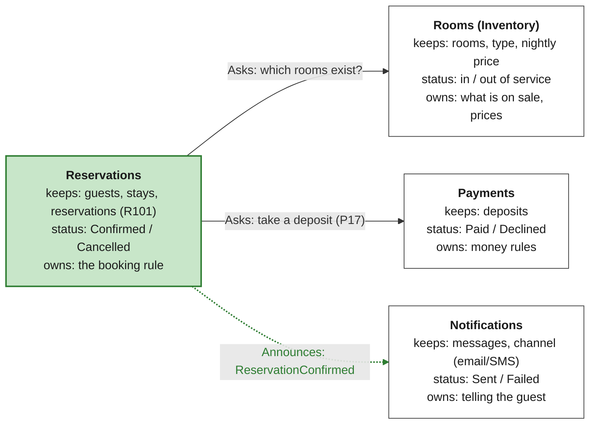

# Hotel contexts

P05 Steps 2–7 for the hotel booking app. Destination in the project: `hotel-booking/docs/contexts.md`.
A **bounded context** is one business area of the hotel with its own words and its own rules.
Inside one context every word has exactly one meaning; the same word may mean something else in
the context next door. Code names are those of the Python code after P04 (`hotel_booking/`).

Sources of the words: requirements R1–R6 (`hotel-booking/docs/requirements.md`), the P04 code,
and the hotel manager's next requests (deposit, out of service, Deluxe price, SMS).

## Words

The ubiquitous language: the manager's words, used the same way in conversation, in this file and
as class and method names.

| Word | Meaning here | Name in our code |
|---|---|---|
| Stay | Check-in to check-out, half-open: 12–14 Nov = the nights of the 12th and 13th | `DateRange` (check_in, check_out) |
| Reservation | Guest + room + stay + status, with an id such as R101 | `Reservation` (id, guest, room, stay, status) |
| Confirmed | The room is promised to this guest for these nights | `ReservationStatus.CONFIRMED` |
| Guest | The person the room is booked for, with a name and an email address (Maya, maya@example.com) | `Guest` (name, email) |
| Room | A room the hotel sells, with a number and a type: R7 Standard, R8 Deluxe | `Room` (number, type) |
| Room type | The kind of room that sets its price and comfort: Standard or Deluxe | `Room.type` |
| Nightly price | What one night in a room costs; depends on the room type (Deluxe costs more than Standard) | not in code yet |
| Out of service | A room taken off sale for some nights, for example R8 during repairs next week | not in code yet |
| Cancelled | The promise is withdrawn; the reservation is kept, but its nights are free again | `ReservationStatus.CANCELLED` |
| Book | Ask for a room for a stay; the answer is Accepted R101, Unavailable or InvalidDates | `BookingService.reserve` (guest, room, stay) |
| Cancel | Withdraw a Confirmed reservation, at the desk or by the guest: Maya cancels R101 | `BookingService.cancel` (reservation_id) → `Reservation.cancel` |
| Free rooms | The rooms with no Confirmed reservation sharing a night with the stay: 12–14 Nov → R7, R8 | `BookingService.find_free_rooms` (stay) |
| Deposit | 30% of the stay's price, taken when the guest books (R8 for 2 nights at 100 → deposit 60) | not in code yet |
| Paid | The deposit was taken successfully | not in code yet |
| Declined | The payment provider refused the deposit; no money was taken | not in code yet |
| Confirmation message | The email or SMS that tells the guest a booking is confirmed: "R101 is confirmed: room R7, 12–14 November" | `NotificationSender.send_confirmation` (reservation) |
| Sent | The provider accepted the message for delivery | not in code yet |
| Failed | The message could not be delivered; it is recorded, and the reservation does not change | not in code yet |

Check (Step 2.5): 18 rows, every row has a meaning, and every code name exists in the code
(checked automatically by `checks/test_p05_docs.py`, evidence E3).

Notes on the code names:

- "Sent" and "Failed" are not in the code as a message status. The nearest things are the
  `sent` counter of the email sender and P04's `BookingResult.notification_failed` (R6). That
  flag is Reservations' *report* that sending raised an error; it is not Notifications' own
  record of a message, which arrives with the P10 queue.
- Prices in the examples (100 per night) are invented for illustration; the hotel has not given
  real prices (**to agree** with the manager).

Words we met but did not add to the 18 (they are answers, technical names or actors, not new
business ideas):

| Word | Where it belongs | Why it is not a row |
|---|---|---|
| Accepted / Unavailable / InvalidDates | Reservations | The three answers to Book (`BookingOutcome`); covered by the row "Book" |
| Reservation id (R101) | Reservations | Part of "Reservation" |
| Overlap / shared night | Reservations | Part of "Stay" and card 1 |
| Refund | Payments | Payments' meaning of "Cancel" (see Same word, different meaning) |
| Channel (email, SMS) | Notifications | Part of "Confirmation message" |
| Website, receptionist | — | Actors that use the app (P03 use cases), not words of a context |

## Rooms

Job: knows which rooms the hotel sells.

| Word | Meaning here |
|---|---|
| Room | A room the hotel sells, with its number, type, nightly price and whether it is in service: R8 Deluxe |
| Room type | Standard or Deluxe; it sets the nightly price |
| Nightly price | What one night in this room costs; Deluxe costs more than Standard |
| Out of service | The room is off sale for some nights (R8 next week, for repairs) and is not offered to guests |

Rules this context owns:
- A room that is out of service is not offered to guests. (card 4)
- The nightly price depends on the room type (Deluxe costs more than Standard). (card 5)

Needs from other contexts: nothing.
Tells other contexts: nothing; it only answers Reservations' questions "which rooms exist?" and, from P17, "what does this room cost for this stay?".

## Reservations

Job: decides whether a guest gets a room for some nights, and keeps every reservation.

| Word | Meaning here |
|---|---|
| Stay | Check-in to check-out, half-open: 12–14 Nov = the nights of the 12th and 13th |
| Reservation | Guest + room number + stay + status, with an id such as R101 |
| Confirmed | The room is promised to this guest for these nights |
| Cancelled | The promise is withdrawn; the nights are free again |
| Guest | The person the room is booked for: name and email address |
| Book | Ask for a room for a stay; answered Accepted R101, Unavailable or InvalidDates |
| Cancel | Withdraw a Confirmed reservation; it is kept as Cancelled and stops blocking the room |
| Free rooms | Rooms (from Rooms' list) with no Confirmed reservation sharing a night with the stay |

Rules this context owns:
- A room never has two Confirmed reservations that share a night. (card 1)
- Check-out must be after check-in. (card 2)
- Cancelling a reservation frees its nights for new bookings. (card 3)

Needs from other contexts: the list of rooms (Rooms); from P17, the price of a room for a stay (Rooms) and a deposit taken, Paid or Declined (Payments).
Tells other contexts: ReservationConfirmed (Notifications).

Reservations is the **core domain**: correct bookings are the reason the hotel wants the app.

## Payments

Job: takes deposits and records whether they were paid.

| Word | Meaning here |
|---|---|
| Deposit | 30% of the stay's price, taken when the guest books, recorded against a reservation id |
| Paid | The deposit was taken; only a Paid deposit can be refunded |
| Declined | The provider refused the payment; nothing was taken, nothing can be refunded |

Rules this context owns:
- The deposit is 30% of the stay's price. (card 6)
- Only a Paid deposit can be refunded. (card 7)

Needs from other contexts: nothing; the reservation id and the stay's price arrive in Reservations' request (decision D1 below).
Tells other contexts: nothing; it answers Reservations' "take a deposit" with Paid or Declined.

## Notifications

Job: tells guests what happened, by email or SMS.

| Word | Meaning here |
|---|---|
| Confirmation message | Notifications' own message for one confirmed reservation: id, guest email, room number, check-in, check-out, and the channel (email or SMS) |
| Sent | The provider accepted the message |
| Failed | The message could not be delivered; it is recorded as Failed and retried or reported |

Rules this context owns:
- A failed message is recorded as Failed and never changes the reservation. (card 8, R6)

Needs from other contexts: nothing; the five fields arrive in ReservationConfirmed.
Tells other contexts: nothing; a failure stays inside Notifications (R6).

Check (Step 3.5): Rooms 4 words, Reservations 8, Payments 3, Notifications 3 = 18; each word is in
exactly one context. "Room" is placed in Rooms, where its meaning is decided; Reservations only
uses the room number.

## Same word, different meaning

| Word | Rooms | Reservations | Payments | Notifications |
|---|---|---|---|---|
| Status | In service / out of service | Confirmed / Cancelled | Paid / Declined | Sent / Failed |
| Room | The full room: R8, Deluxe, its nightly price, in or out of service | Only the number R8 written on a reservation | Not used (a deposit belongs to a reservation id, not a room) | Text inside the message: "Room R8" |
| Cancel | Take a room off sale (out of service) | Withdraw a reservation: Confirmed → Cancelled, its nights become free | Refund a deposit (only if it was Paid) | Not used (a sent message cannot be unsent) |
| Guest (our own addition) | Not used | The person who holds the reservation: name and email | The payer of the deposit | Only an address: the email (or phone number for SMS) to send to |

What would go wrong with one shared status: if Notifications could set a reservation's status to
Failed, a failed confirmation email to Maya would overwrite R101's Confirmed with Failed, R7 would
look free again for 12–14 Nov, Omar could book it, and Maya would lose her room because of a
message — breaking R6 (a failed message keeps the booking) and, through it, the booking rule R3.

So each context keeps its own status, and no field or class is shared for two meanings. Today only
Reservations' status exists in the code (`ReservationStatus`); in P06 Notifications gets its own
`Confirmation` type instead of using Reservations' `Reservation` class.

## Rule owners

The owner of a rule is the context that keeps all the data the rule has to read.

| Card | Rule | Owner | Why this owner |
|---|---|---|---|
| 1 | A room never has two Confirmed reservations that share a night. | Reservations | It keeps every reservation of the room, so it can check them all together. |
| 2 | Check-out must be after check-in. | Reservations | The stay is its word, and it refuses wrong dates before it asks anyone anything (InvalidDates). |
| 3 | Cancelling a reservation frees its nights for new bookings. | Reservations | It keeps the status, and only Confirmed reservations block a room; Cancelled ones do not. |
| 4 | A room that is out of service is not offered to guests. | Rooms | It knows which rooms are on sale and when; Reservations only sees the rooms Rooms offers. |
| 5 | The nightly price depends on the room type (Deluxe costs more than Standard). | Rooms | It keeps each room's type and its price. |
| 6 | The deposit is 30% of the stay's price. | Payments | Money rules belong to Payments; it is handed the stay's price (which Rooms calculates) and applies the 30% itself. |
| 7 | Only a Paid deposit can be refunded. | Payments | It keeps the deposit's status (Paid or Declined). |
| 8 | A failed message is recorded as Failed and never changes the reservation. | Notifications | It keeps the message status; it never holds Reservations' data, so it cannot change it (R6). |

Check (Step 5.4): each card has exactly one owner, and every context section above lists at least
one rule. Compared with the course's answers for all eight cards: same owners. Card 6's reason
differs on purpose — see decision D1.

## Context map

Source: [context-map.mmd](../../practices/P05-domain-context-boundaries/diagrams/context-map.mmd) (rendered:
[context-map.svg](../../practices/P05-domain-context-boundaries/diagrams/context-map.svg)); draw.io page "Context map":
[diagrams.drawio](diagrams.drawio) (copied in P06 from
[the P05 file](../../practices/P05-domain-context-boundaries/diagrams/context-map.drawio); the same file
holds the P06 page "Modules").

4 boxes, 1 of them green (Reservations, owner of the booking rule); 3 labelled arrows, all
starting at Reservations; 2 solid (questions), 1 green dotted (event). Rooms, Payments and
Notifications never call Reservations; P06's architecture checks keep it that way.

## Between contexts

### Reservations → Notifications: ReservationConfirmed (event)

Sent when: a reservation is saved as Confirmed (after `save`, never before).

Fields:
- reservationId: R101
- guestEmail: maya@example.com
- roomNumber: R7
- checkIn: 2026-11-12
- checkOut: 2026-11-14

Reservations does not wait for an answer. A failed message never changes R101 (rule R6).

Never crosses: Reservations' list of reservations, the `Reservation` object itself, other guests'
data and the booking rule. Notifications never reads them. Nothing comes back: Sent or Failed
stays in Notifications.

In code: P04 still calls `NotificationSender.send_confirmation(reservation)` with the whole
`Reservation`. P06 replaces the argument with Notifications' own `Confirmation` (the five fields
above, snake_case in Python); P10/P15 turn the call into a real message on a queue.

### Reservations → Rooms: which rooms exist? (question)

Sent when: on every free-room search (R1) and every booking (R2), before the booking rule runs.

What Reservations sends: nothing today (the whole list). From the practice that adds "out of
service": the stay (check-in, check-out), so Rooms can leave out rooms that are off sale on any
night of it.

The answer and its fields: one entry per room on sale —
- number: R7 / R8
- type: Standard / Deluxe
- nightlyPrice: from the practice that adds prices (to agree)

From P17 the same arrow carries a second question, "what does this room cost for this stay?":
sends roomNumber R8, checkIn 2026-11-12, checkOut 2026-11-14; answer: stayPrice (2 nights × the
nightly price). Keeping this sum in Rooms keeps every price rule (card 5, later seasonal prices)
in one place.

Never crosses: any reservation, guest or status — Rooms never learns who booked a room; Rooms'
own storage (a list today, a table later) — Reservations sees only the contract.

### Reservations → Payments: take a deposit (question, from P17)

Sent when: from P17, during a booking, after the room is held and before it is Confirmed (the
booking saga: hold the room, take the deposit, confirm, or undo).

What Reservations sends:
- reservationId: R101
- amount: the deposit to take, e.g. 60 — calculated by Payments' own deposit rule from the
  stay's price (stayPrice 200 → 30% = 60), see decision D1

The answer and its fields:
- status: Paid or Declined

Reservations decides what the answer means for the booking (Paid → Confirm; Declined → release
the room and answer the guest). Payments never decides whether R7 is free.

Never crosses: card or provider details (they stay in Payments); Reservations' list of
reservations; the booking rule. A Paid deposit is not a reservation.

Check (Step 7.5): one subsection for each arrow of the context map (3), each with its fields.

## Decisions and open questions

- **D1 · Who computes the deposit amount (card 6)?** The course's example reason says Payments
  "asks Rooms for the nightly price". That would be a fourth arrow (Payments → Rooms) and would
  contradict the map, where every arrow starts at Reservations. Decision: Rooms calculates the
  stay's price (answer to Reservations' second question), Reservations hands that price to
  Payments, and Payments alone applies the 30% (`deposit_for(stay_price)` next to
  `take_deposit(reservation_id, amount)` in its contract). The rule keeps one owner, Payments
  needs nothing from other contexts, and the map keeps three arrows. Cost: one extra question on
  the booking path. Revisit in P17 if the saga makes another shape simpler.
- **D2 · Does a Reservation hold a `Room` or only a room number?** In this language Reservations
  only uses the number. The P04 code stores the whole `Room` (number and type). P06 may keep
  `Room` as a type imported from Rooms' public contract (allowed), to keep the 8 tests unchanged;
  storing only `room_number` is the cleaner model and is noted for P07, when reservations get a
  database table.
- **Open · ReservationCancelled.** Cancelling after a Paid deposit will need a refund (Payments)
  and maybe a message (Notifications). No requirement asks for it yet, so the event is not on the
  map; it arrives with the saga (P17).

## P06 status (added when this file was copied into the project)

The text above is the P05 design, copied unchanged except for the diagram links. What P06 made
of it, so a reader of the project does not need the practice folders:

| P05 item | In the code since P06 |
|---|---|
| Four contexts | Four packages: `hotel_booking/rooms`, `reservations`, `payments`, `notifications`, each with a contract (`__init__.py`) and `internal.py` |
| Words table: Paid, Declined | `PaymentStatus.PAID`, `PaymentStatus.DECLINED` (`hotel_booking/payments`) |
| Words table: Confirmation message | `Confirmation` (5 fields) passed to `NotificationSender.send_confirmation(confirmation)` |
| Border "which rooms exist?" | `RoomCatalog.all()`; the wiring passes `catalog.all()` into `BookingService` |
| Border "take a deposit" | `PaymentService.take_deposit(reservation_id, amount: Decimal)`; not called before P17 |
| Border "ReservationConfirmed" | `BookingService` builds the `Confirmation` after `save` |
| "Never crosses" lines | `.importlinter` (3 forbidden contracts) + `tests/test_architecture.py` |
| D1 `deposit_for(stay_price)` | **Not added in P06** (the course's P06 contract has `take_deposit` only and nothing would call it); stays proposed for P17 |
| D2 Room vs room number | P06 keeps `Room` from the Rooms contract (allowed by rule 1); `room_number` only is still noted for P07 |

Decision record: [adr-001-modular-monolith.md](adr-001-modular-monolith.md).
