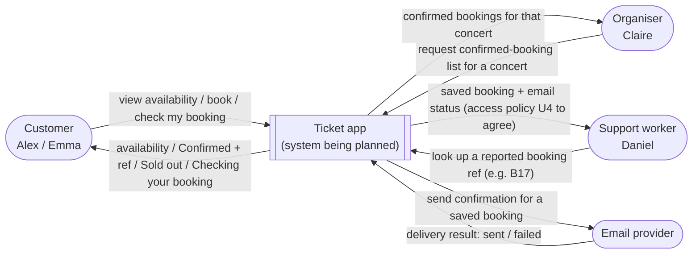

# System context

The box is the system we are planning — the **Ticket app**. Everyone else is outside it. This
sketch shows only *outside conversations*; internal modules (Booking, Storage, Notification) are
deliberately left out and described in the ADR.

## Text version (same arrows, same labels)

| From | To | Message |
|---|---|---|
| Customer | Ticket app | view availability / book / check my booking |
| Ticket app | Customer | availability / Confirmed + ref / Sold out / Checking your booking |
| Organiser Claire | Ticket app | request confirmed-booking list for a concert |
| Ticket app | Organiser Claire | confirmed bookings for that concert |
| Support Daniel | Ticket app | look up a reported booking ref (e.g. B17) |
| Ticket app | Support Daniel | saved booking + email status (access policy U4 to agree) |
| Ticket app | Email provider | send confirmation for a saved booking |
| Email provider | Ticket app | delivery result: sent / failed |

The email delivery result updates the booking's email status (`pending` → `sent` or `failed`,
see [Glossary.md](Glossary.md)); it never changes whether the booking is Confirmed.

## Limits

These arrows describe who communicates and what each message means. They do not choose a
framework, a database or a network protocol, and they do not prove that access is secure or
that an application works. Status: **Proposed**.
