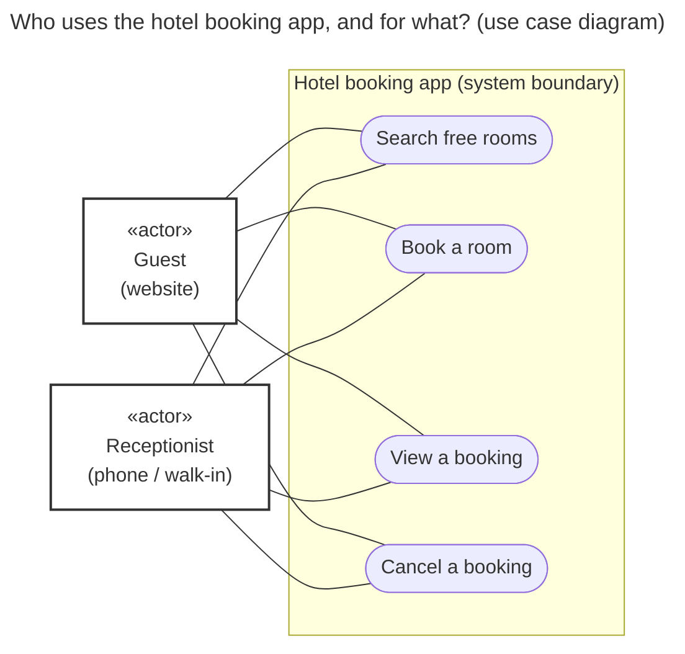
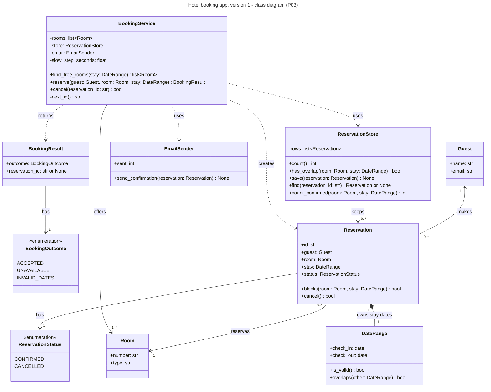
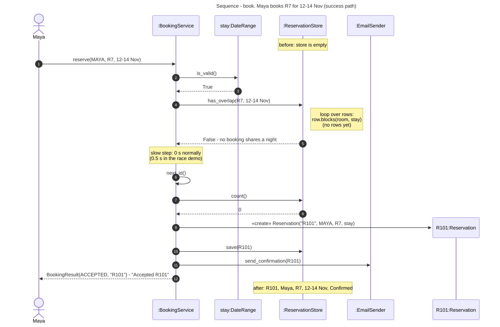
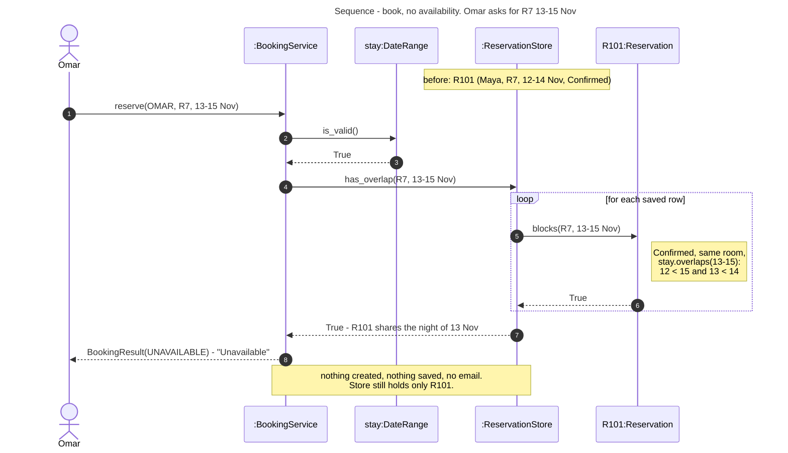
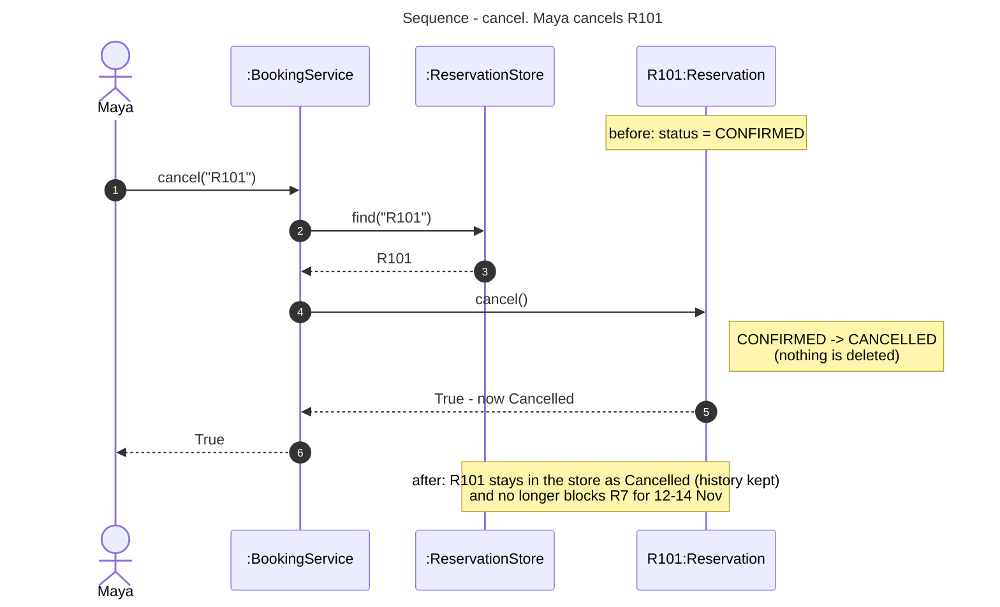
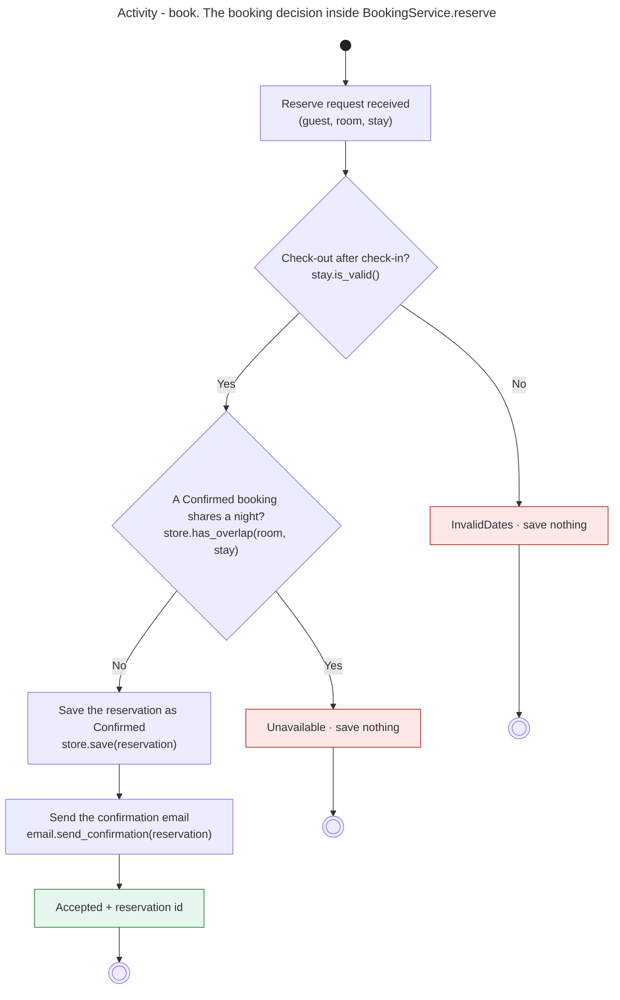
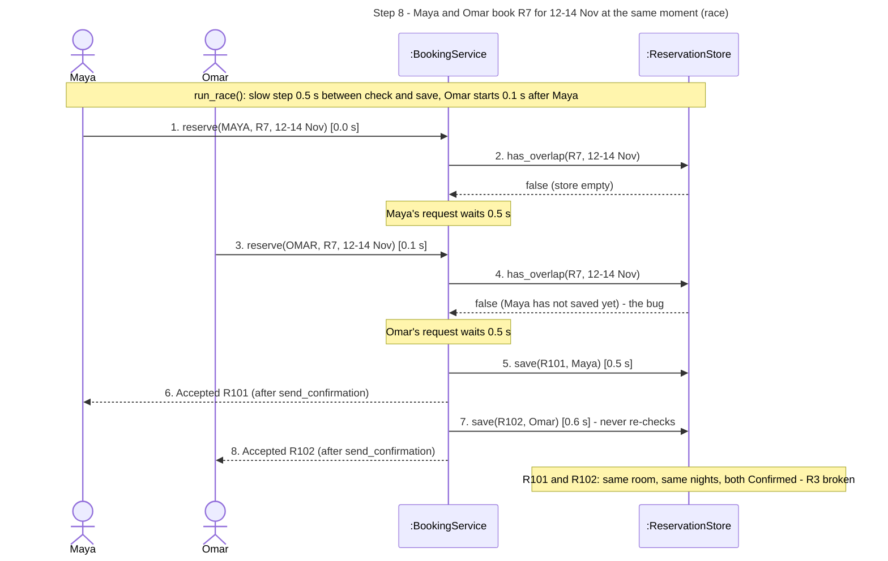
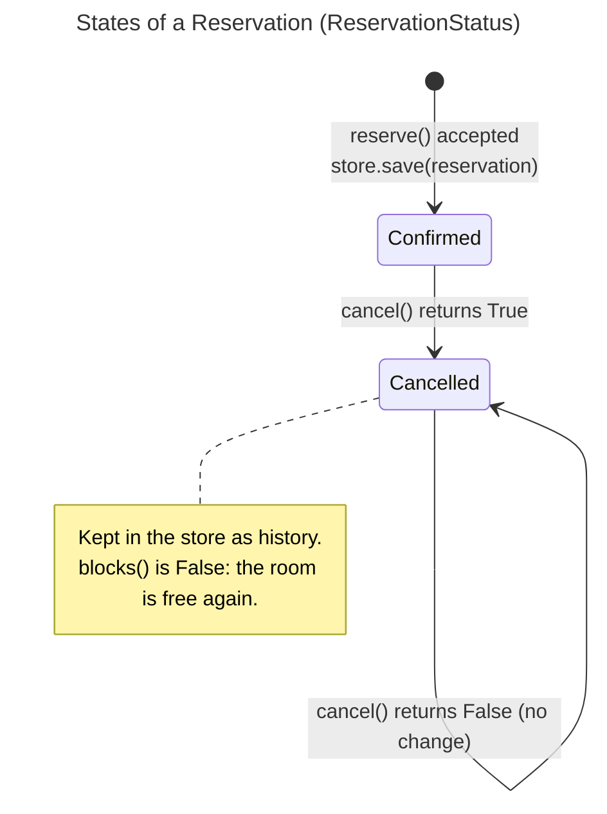

# P03 — UML diagrams

All diagrams are written as Mermaid source (`uml/*.mmd`), render-checked with the Mermaid CLI
(`mmdc` 11.16) and exported to SVG next to the source. The activity sheet asks for draw.io pages;
see the README for the substitution and how to import these into draw.io.

The diagrams describe **the code in `hotel-booking/` exactly** (version 1). Where they are more
detailed than the course's completed diagrams, the difference is listed at the end of this file
and is there so that every class, member, multiplicity and message matches the code.

| # | Activity-sheet page | Diagram here | Checked against the code by |
|---|---|---|---|
| 1 | Use cases | [Use case diagram](#1-use-cases) | Each use case maps to one method (table below) |
| 2 | Classes | [Class diagram](#2-classes) | `tests/test_uml_conformance.py` (classes, attributes, operations, enum values, 11 links) |
| 3 | Sequence - book | [Maya books R7](#3-sequence---book-success-path) | `tests/test_sequences.py::test_sequence_book_maya_r7` |
| 3b | (L02 / curriculum plan: no-availability path) | [Omar is refused](#3b-sequence---book-no-availability-path) | `test_sequence_unavailable_omar_r7` |
| 4 | Sequence - cancel | [Maya cancels R101](#4-sequence---cancel) | `test_sequence_cancel_r101` |
| 5 | Activity - book | [The booking decision](#5-activity---book) | `test_sequence_invalid_dates_stops_before_the_store`, `test_r3_*` |
| 6 | Step 8 "message by message" | [The race](#6-the-race-step-8) | `test_sequence_race_both_checks_before_either_save`, `test_race_double_books_r7_known_defect` |
| 7 | (L02 page 16: states) | [Reservation states](#7-reservation-states) | `TestReservation::test_cancel_once_then_again` |

## 1. Use cases

Source: [uml/use-case-diagram.mmd](uml/use-case-diagram.mmd) · rendered: [uml/use-case-diagram.svg](uml/use-case-diagram.svg)

2 actors outside the boundary, 4 use cases inside, 8 plain association lines (no arrowheads:
an association says nothing about order). Checking dates and saving are steps *inside* "Book a
room", not goals of their own, so they are not drawn.

| Use case | Method in the code | Requirement |
|---|---|---|
| Search free rooms | `BookingService.find_free_rooms(stay)` | R1 |
| Book a room | `BookingService.reserve(guest, room, stay)` | R2, R3 |
| Cancel a booking | `BookingService.cancel(reservation_id)` | R4 |
| View a booking | `ReservationStore.find(reservation_id)` | R5 |

Sentences for the Cancel lines: *A guest cancels her own booking on the website.* *A receptionist
cancels a booking for a guest who phones.* When Nora phones the hotel, the **receptionist** is the
actor (she uses the app); Nora is still the guest stored on the reservation.

Use case description "Book a room" (main success scenario): (1) the guest enters 12–14 Nov and
asks for free rooms; (2) the app shows R7, R8; (3) the guest chooses R7 and presses Book; (4) the
app checks nobody has R7 on the nights of the 12th and 13th; (5) the app saves R101 and sends a
confirmation email; (6) the guest sees "Accepted, your reservation id is R101".
Alternative flows: at step 1 dates 15–15 → "InvalidDates", nothing saved; at step 4 a Confirmed
booking shares a night → "Unavailable", nothing saved.

## 2. Classes

Source: [uml/class-diagram.mmd](uml/class-diagram.mmd) · rendered: [uml/class-diagram.svg](uml/class-diagram.svg)

**Notation.** Box = class (name / attributes / operations). `+` public, `-` private (a leading
underscore in Python). `«enumeration»` = fixed list of values. Solid arrow = navigable
association (the class at the tail holds a reference). Filled diamond = composition (the owner is
at the diamond). Dashed arrow = dependency ("uses / creates / returns"). Numbers = multiplicity.
`list~Room~` is Mermaid's way to write `list[Room]`. Reservation's attributes are read-only
properties; its status changes only through `cancel()`.

| Link | Multiplicity | Kind | Why this kind | In the code | Requirement it serves |
|---|---|---|---|---|---|
| Guest — Reservation "makes" | Guest 1, Reservation 0..* | association (navigable Reservation → Guest) | Maya exists without bookings and may have many; each booking is for exactly one guest | `Reservation.guest` | R2 (book *for a guest*), R5 (view shows the guest) |
| Reservation — Room "reserves" | Reservation 0..*, Room 1 | association | R7 exists before and after any booking; many bookings of R7 over time | `Reservation.room` | R2, R3 (clash is per room) |
| Reservation ◆— DateRange "owns stay dates" | 1 — 1 | composition | the dates belong to this reservation alone and mean nothing without it; immutable value | `Reservation.stay` | R3 (nights compared), R5 |
| Reservation — ReservationStatus "has" | 1 | association to an enumeration | exactly one of Confirmed / Cancelled at any time | `Reservation.status` | R3 (only Confirmed blocks), R4 |
| ReservationStore — Reservation "keeps" | 0..* | association | the store holds every saved booking, Cancelled ones included (history) | `ReservationStore._rows` | R1, R3, R4, R5 |
| BookingService — Room "offers" | 1..* | association | the service knows the hotel's rooms to search | `BookingService._rooms` | R1 |
| BookingService ··> ReservationStore "uses" | — | dependency | handed in from outside, not owned; called to check, save, find | `_store.has_overlap/count/save/find` | R1–R5 |
| BookingService ··> EmailSender "uses" | — | dependency | handed in; called after a successful save | `_email.send_confirmation` | R2 (confirmation) |
| BookingService ··> Reservation "creates" | — | dependency | `reserve` instantiates the reservation | `Reservation(self._next_id(), …)` | R2 |
| BookingService ··> BookingResult "returns" | — | dependency | the answer of `reserve` | `return BookingResult(...)` | R2, R3 |
| BookingResult — BookingOutcome "has" | 1 | association to an enumeration | exactly one of Accepted / Unavailable / InvalidDates | `BookingResult.outcome` | R2, R3 |

**Composition versus inheritance.** A Reservation is *not a kind of* Room, so there is no
inheritance (hollow triangle) between them — a reservation *refers to* a room. Room type
("Standard", "Deluxe") is a field, not a `SuiteRoom` subclass, because in version 1 a type has no
data or behaviour of its own. Sending a confirmation is a separate job, so it is a separate class
that BookingService *uses* rather than an `EmailBookingService` subclass. Version 1 has no
inheritance at all, which is a deliberate result of the analysis, not an omission.

## 3. Sequence - book (success path)

Source: [uml/sequence-book.mmd](uml/sequence-book.mmd) · rendered: [uml/sequence-book.svg](uml/sequence-book.svg)

Order that matters: the check (4) comes before the save (10); the save comes before the email (11),
so no email is ever sent for a booking that was not saved; Maya hears "Accepted" only at the end
(12). The course's 6-message version maps to arrows 1, 4, 5, 10, 11, 12 here; arrows 2–3
(`is_valid`), 6–8 (`next_id` → `count`) and 9 (creation of R101) are shown because the code does
them.

## 3b. Sequence - book, no-availability path

Source: [uml/sequence-unavailable.mmd](uml/sequence-unavailable.mmd) · rendered: [uml/sequence-unavailable.svg](uml/sequence-unavailable.svg)

The first arrows are the same as the success path; after the store answers `True` the request ends
with "Unavailable": no `count`, no creation, no `save`, no `send_confirmation`. Refusing is a normal
answer and the saved data does not change.

## 4. Sequence - cancel

Source: [uml/sequence-cancel.mmd](uml/sequence-cancel.mmd) · rendered: [uml/sequence-cancel.svg](uml/sequence-cancel.svg)

The fourth participant is one *object*, reservation R101. Find (2) must come before Cancel (4): a
reservation that has not been found cannot be cancelled. The reservation changes its own status;
nothing is deleted, so the history is kept and R7 is free again for 12–14 Nov.

## 5. Activity - book

Source: [uml/activity-book.mmd](uml/activity-book.mmd) · rendered: [uml/activity-book.svg](uml/activity-book.svg)

Filled circle = start; diamond = yes/no decision (one `if` in `reserve`); rectangle = action;
bullseye = end. The two diamonds are the two `if` statements at the top of
`BookingService.reserve`. Traces for Omar R7 13–15, Nora R7 14–16 and Omar R8 15–15 are in
[hotel-booking/docs/design-notes.md](../../hotel-booking/docs/design-notes.md#activity-traces).

## 6. The race (Step 8)

Source: [uml/sequence-race.mmd](uml/sequence-race.mmd) · rendered: [uml/sequence-race.svg](uml/sequence-race.svg)

| Time | Maya's request | Omar's request | Reservations in the store |
|---|---|---|---|
| 0.0 s | Checks R7: nobody there | — | none |
| 0.1 s | Waiting (slow step) | Checks R7: nobody there | none |
| 0.5 s | Saves R101 → Accepted | Waiting | R101 |
| 0.6 s | — | Saves R102 → Accepted | R101 and R102, same room, same nights |

Both checks (2 and 4) happen before either save (5 and 7): check-then-act is not atomic. In the
course's drawing both saves come before both replies; here Maya's reply (6) is drawn before Omar's
save (7) because that is the order the code produces (`test_sequence_race_both_checks_before_either_save`
records it).

## 7. Reservation states

Source: [uml/state-reservation.mmd](uml/state-reservation.mmd) · rendered: [uml/state-reservation.svg](uml/state-reservation.svg)

| Now | Action | Afterwards | `cancel()` returns |
|---|---|---|---|
| (new) | `reserve` succeeds | Confirmed | — |
| Confirmed | cancel | Cancelled | True |
| Cancelled | cancel again | Cancelled | False |

## Differences from the course's completed diagrams

| Course diagram | Here | Reason |
|---|---|---|
| Class diagram: 8 boxes, 7 links | 10 boxes, 11 links | Added `BookingResult` and its `BookingOutcome` enumeration (the code returns them), `BookingService → Room` (the `rooms` list), and `BookingService ··> Reservation «creates»`, so the diagram is the code. |
| `BookingResult.outcome` is a string | `BookingOutcome` enumeration | A fixed list of three answers is safer to compare than free text; `str(result)` still prints `Accepted R101`. |
| `ReservationStore` without `count()`; `BookingService` without private members | `count()`, `-next_id()`, `-store`, `-email`, `-slow_step_seconds` shown | The code uses them; `slow_step_seconds` exists only to make Step 8 visible. |
| Plain lines for "makes" / "reserves" | Navigable arrows from Reservation | In the code only Reservation holds the reference; Guest and Room do not know their reservations. |
| Sequence - book: 6 messages | 12 messages | Adds `is_valid`, `next_id`/`count` and the creation of R101, which the code performs. |
| Race: saves 5, 6 then replies 7, 8 | save, reply, save, reply | The order the code produces (recorded by a test). |
| draw.io pages | Mermaid + SVG | See README "Substitutions". |
