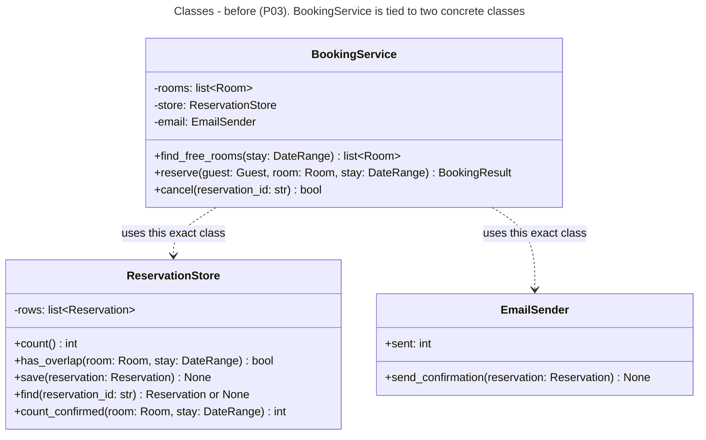
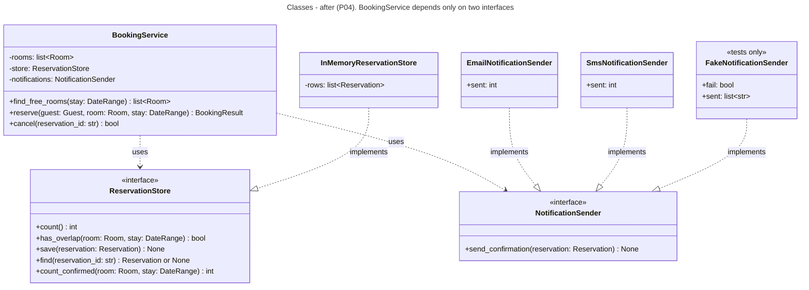
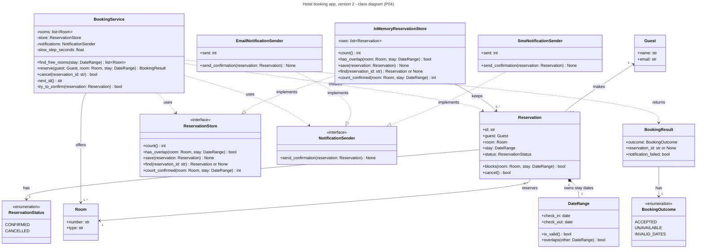
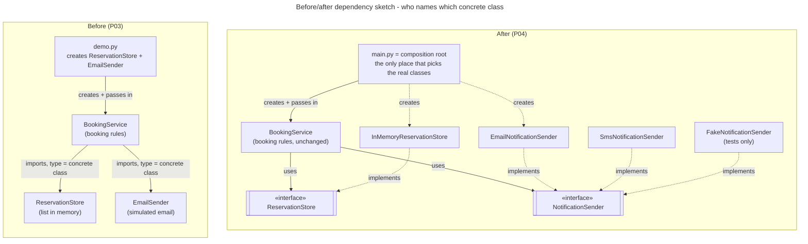
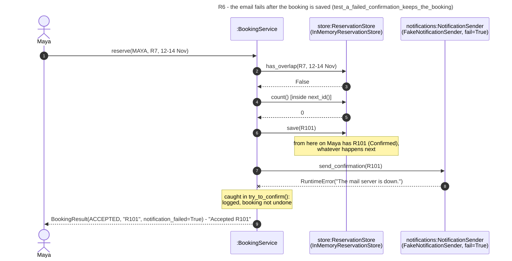

# P04 — Diagrams (before and after the refactoring)

All diagrams are Mermaid sources in [uml/](uml/), render-checked with the Mermaid CLI (`mmdc` 11.16,
headless Chromium) and exported to SVG next to the source. The activity sheet asks for a draw.io page
"Classes - after"; see the README "Substitutions" for why Mermaid and how to import it into draw.io.
Python names are used (`ReservationStore`, `NotificationSender`); the C# tab of the course calls the
same interfaces `IReservationStore` and `INotificationSender`.

| # | Diagram | Activity sheet / plan | Checked against the code by |
|---|---|---|---|
| 1 | [Classes - before](#1-classes---before-p03) | Step 4 "Before: the P03 design" | P03 snapshot (evidence O0); `tests/test_uml_conformance.py` of P03 |
| 2 | [Classes - after](#2-classes---after-the-activity-sheet-page) | Step 4 "Your turn" (2 interfaces, 5 classes, 2 uses, 4 implements) | `test_classes_after_page_has_the_counts_of_the_p04_checklist`, `test_classes_after_page_implements_lines_hold_in_the_code` |
| 3 | [Class diagram, version 2 (full)](#3-class-diagram-version-2-full) | Keeps code == UML (P03 rule) | `tests/test_uml_conformance.py` (20 tests) |
| 4 | [Before/after dependency sketch](#4-beforeafter-dependency-sketch) | Curriculum plan: "Produce: before/after dependency sketch" | `tests/test_dependency_rule.py` (3 tests) |
| 5 | [Sequence - R6 failed confirmation](#5-sequence---r6-the-email-fails-after-the-booking-is-saved) | Step 7.2 diagram | `tests/test_sequences.py::test_sequence_r6_failed_confirmation` |

## 1. Classes - before (P03)

Source: [uml/class-before.mmd](uml/class-before.mmd) · rendered: [uml/class-before.svg](uml/class-before.svg)

Both dashed "uses" arrows end at **concrete** classes. To keep bookings in PostgreSQL (P07), send SMS,
or make the email fail in a test, `BookingService` itself would have to be edited — although its
booking rules do not change. (Guest, Room, DateRange, Reservation are left out, as in the course
diagram; the full P03 diagram is
[P03 uml/class-diagram.mmd](../P03-hotel-domain-uml/uml/class-diagram.mmd).)

## 2. Classes - after (the activity-sheet page)

Source: [uml/classes-after.mmd](uml/classes-after.mmd) · rendered: [uml/classes-after.svg](uml/classes-after.svg)

Checklist of the activity sheet: **2 interfaces** (`ReservationStore`, `NotificationSender`),
**5 classes** (`BookingService`, `InMemoryReservationStore`, `EmailNotificationSender`,
`SmsNotificationSender`, `FakeNotificationSender` «tests only»), **2 "uses"** arrows (dashed, open
head) and **4 "implements"** lines (dashed, hollow triangle). The counts are asserted by a test that
parses this file, and each "implements" line is checked against the code (same methods, same
parameter names), including the fake that lives in `test_booking_service.py`.

Reading it: `BookingService` (top) never names a bottom-row class, so any of them can be plugged in —
email or SMS in the app, the fake in the tests, later a PostgreSQL store. Who plugs them in is
`main.py` (`build_app`), the composition root.

## 3. Class diagram, version 2 (full)

Source: [uml/class-diagram.mmd](uml/class-diagram.mmd) · rendered: [uml/class-diagram.svg](uml/class-diagram.svg)

Differences from the P03 class diagram, one line each:

| Change | Kind | Why |
|---|---|---|
| `ReservationStore` became an «interface» (5 operations, no data) | refactoring | D: BookingService depends on the promise |
| `InMemoryReservationStore` (new name for the P03 list store) implements `ReservationStore` | refactoring (rename) | The name says where the rows live; P07 adds a database store next to it |
| `NotificationSender` «interface» (1 operation) | refactoring | D + I: one small promise, "tell the guest" |
| `EmailNotificationSender` (new name for `EmailSender`) implements `NotificationSender` | refactoring (rename) | The name says what it does |
| `BookingService -email` → `-notifications: NotificationSender`; "uses" arrows now end at interfaces | refactoring | D |
| `BookingResult +notification_failed: bool`, `BookingService -try_to_confirm()` | **behaviour (R6)** | Added after the refactoring, test first |
| `SmsNotificationSender` implements `NotificationSender` | **feature** | O: added without editing `BookingService` |
| Domain classes, enums, multiplicities, composition | unchanged | Nothing about the booking rules changed |

14 relationship lines: 11 as in P03 (the store's "keeps" line moved to `InMemoryReservationStore`) plus
3 "implements". Interfaces are `typing.Protocol` classes; "implements" is structural in Python (no
inheritance in the code), which is why the conformance test compares method names and parameter names
instead of looking for a base class.

## 4. Before/after dependency sketch

Source: [uml/dependency-before-after.mmd](uml/dependency-before-after.mmd) · rendered: [uml/dependency-before-after.svg](uml/dependency-before-after.svg)

Before, `BookingService` imported and was typed with the concrete classes, and `demo.py` created them.
After, the booking rules depend only on the two promises; the arrows from the concrete classes point
**up** to the promises (dependency inversion), and `main.py` is the one place that creates real
objects. `tests/test_dependency_rule.py` reads the source with `ast` and fails if `booking.py` names a
concrete store or sender, or if any module other than `main.py` creates one.

## 5. Sequence - R6: the email fails after the booking is saved

Source: [uml/sequence-r6-failed-confirmation.mmd](uml/sequence-r6-failed-confirmation.mmd) · rendered: [uml/sequence-r6-failed-confirmation.svg](uml/sequence-r6-failed-confirmation.svg)

`save(R101)` (6) comes before `send_confirmation(R101)` (7), so the failure (8, a dashed reply with a
cross = an exception) cannot lose the booking. `BookingService` catches it in `_try_to_confirm`,
logs a warning and still answers `Accepted R101` with `notification_failed=True` (9). The course's
version of this diagram has 7 arrows; this one also shows `count()` (4–5), the id lookup inside
`next_id()`, because the spy test records it. The message order is recorded from the running code
by `test_sequence_r6_failed_confirmation`.

## P03 diagrams after the refactoring

The P03 sequence diagrams (book, no availability, cancel, race) still describe version 2: the
participants are now typed by the promises (`store: ReservationStore`, `notifications:
NotificationSender`), but every message and its order are the same — `tests/test_sequences.py` passes
unchanged apart from the renamed spy base classes. The only addition inside `reserve` is the private
self-call `_try_to_confirm`, which wraps the same `send_confirmation` message.
